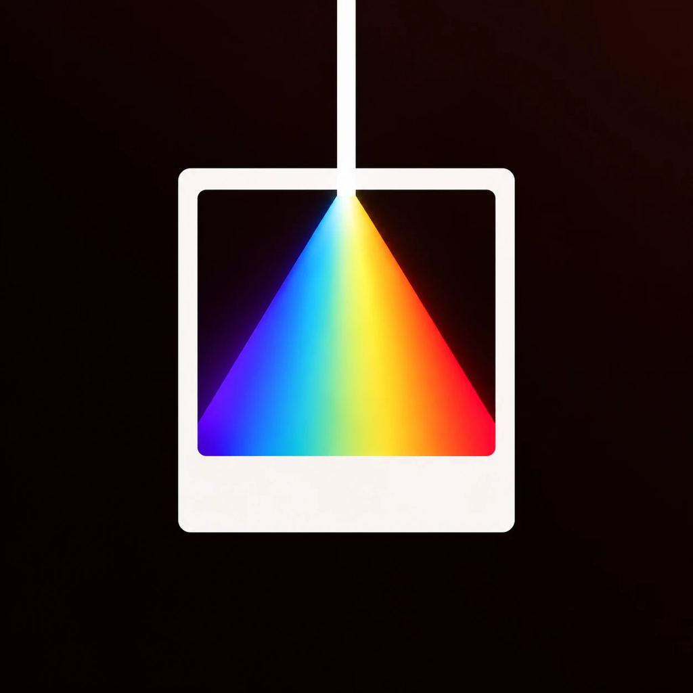

<p align="center">
  
</p>

# RA4 Light Lab · RA4追光暗房 — spectral film simulation for iPad and iPhone

**RA4 Light Lab** (**RA4追光暗房** in Chinese) brings
[SpektraLab](https://github.com/JamesQiu2005/SpektraLab)'s spectral film
simulation to iPad and iPhone. It is named after RA-4, the colour print process
whose paper it simulates. It runs SpektraLab's C++/Metal film engine,
**unmodified**, on the device's GPU: a RAW goes through a virtual film negative
and a print, with its grain, halation and paper, in a second or two at full
resolution.

> Built on SpektraLab by Hanze Qiu and spektrafilm by Andrea Volpato, and
> independent of both: neither project endorses it. For the macOS app, see
> [SpektraLab](https://github.com/JamesQiu2005/SpektraLab). This branch,
> `ios-port`, is the iPad and iPhone work; `main` is an untouched copy of
> SpektraLab.

## Status

| Phase | What | |
|---|---|---|
| 1 | The original Mac app builds from source (Xcode 27.1) | ✅ |
| 2 | Feasibility: the engine compiles for iPadOS with no source changes, and a 40.6 MP RAW renders at full resolution on an iPad | ✅ |
| 3 | Colour pipeline, post-processing adjustments, sRGB JPEG export | ✅ |
| 4 | The engine's film, camera, format, Scene Placement and print settings | ✅ |
| 5 | Saved edits, undo/redo, a photo library | ✅ |
| 6 | A designed interface: canvas first, a tool strip, English and Simplified Chinese | ⏳ on the iPad for review |
| 7 | Crop, straighten, rotate and flip; zoom to 100 % with a full-resolution view; before/after; the camera's white balance and lens correction | ✅ verified by self-test; ⏳ the touch controls, by hand |
| 8 | Black and white: a lens filter and the paper grade | ✅ verified by self-test |
| next | More adjustments, copy/paste settings, export options — see [Roadmap](#roadmap) | ⏳ |

## What the iPad app does today

**The interface**
- **Canvas first**: the photograph takes the screen. A strip of seven tools
  on the right, in darkroom order — **Film, Camera, Effects** (the negative),
  **Print**, then **Crop, Adjust, Export** (the finish) — opens one panel at a
  time beside it, or none. Tap the photo to see it alone; at fit, swipe it
  sideways for the next or previous photo. A before/after button sits in the
  top bar.
- Always dark, neutral greys around the picture, a safelight-amber accent.
- **The enlarger transition**: choosing another film or paper turns the
  picture into its negative at once (orange-masked for colour, grey for
  black and white, dimmed for a slide); when the new print has rendered, a
  warm light sweeps across and the print develops in behind it. Off in
  Settings, and under Reduce Motion.
- Films are **tiles** (maker, name, speed); the Camera panel **draws the
  scene's range against the film's latitude**. Sliders fill from zero, and
  the white-balance ones are colour ramps.
- **English or Simplified Chinese**, following the iPad's language (the Mac
  app's Chinese wording; film and paper names stay English, as there).
- On an **iPhone** (and the iPhone Duo, folded or open, or an iPad in a
  narrow Split View) the tools become a bottom bar and the panel sits under
  the photo; the library opens as a sheet. A phone on its side puts the panel
  beside the photo instead.
- **Settings** (the gear) holds the language, credits and licences, and the
  diagnostics: timings, memory, a full-resolution test render.

**Library and editing**
- Import RAWs (or JPEG/HEIC/TIFF) **from Files or from Photos** (the original
  RAW when the photo has one); the **library** column shows each photo as it
  was last left, with Previous / Next in the top bar and ← → on a keyboard.
- Edits **save automatically** per photo and come back after a restart; the
  photo itself is never written. **Undo / Redo**, one step per slider drag.
- **Photo information** on a see-through card over the picture: date and
  time, camera, lens, focal length, aperture (worked out from the APEX value
  when a manual lens records none), shutter, ISO, exposure mode and metering,
  the white balance as the camera set it and as shot in kelvin and tint, the
  file's format and size, and its location when it has one. No serial numbers.

**The frame**
- **Crop, straighten, rotate, flip** with the Mac app's arithmetic: aspect
  presets (free, original, 1:1, 3:2, 4:3, 16:9, 5:4, 7:5, across or upright),
  a straighten of ±45° that turns the photo under a level frame, quarter
  turns and flips. The crop always stays inside the photograph; the export
  and the library's thumbnail follow it.
- **Zoom** from fit to 400 % (pinch, or double-tap for 100 %) and pan. Past
  what the live preview holds, the full-resolution print takes its place
  after a moment's stillness, so 100 % shows the real grain.
- **Before/after**: a divider across the photo, or touch and hold to see it
  without the film — Apple's own development of the RAW, cropped the same way.

**The film** — the original's engine settings, with the Mac app's defaults
- **Camera white balance** in kelvin and tint at the RAW decode — As Shot,
  Daylight, Cloudy, Shade, Tungsten, Fluorescent, or an eyedropper — so the
  film is exposed to a scene already balanced, and the lens's own correction
  where the RAW carries one. A change develops the photo again (about 1 s).
- **34 stocks** from the Mac app's own catalogue: colour negatives, slide films
  (scanned, no paper) and black-and-white films (printed on Ilford Multigrade).
- **Black and white**, ahead of the Mac app (whose engine has both and whose
  interface does not yet): a **colour filter on the lens** — Kodak Wratten
  yellow 8, yellow-green 11, deep yellow 12 and 15, orange 21, red 25, blue 47,
  green 58 — that moves how each colour turns grey with mid-grey's exposure
  held, and the **paper grade**, Multigrade 00 to 5.
- **Camera:** metering (Balanced, Center, Protect highlights / shadows, or
  off) and film exposure.
- **Film effects:** grain, halation and scatter, highlight boost, anti-halation
  layer, colour couplers, glare — each with its strength.
- **Film format:** 110, APS, 135, 120, custom and cine formats; grain and
  halation are sized in real micrometres on the chosen film.
- **Scene Placement:** the film's latitude against the scene's range, and
  highlight / shadow pull-backs that the engine solves (and refuses when it
  can't place them).
- **Print:** Print Effects and EDR.

**Colour, adjustments and export**
- **ProPhoto RGB throughout**, as in the Mac app, converted once per
  destination through the engine's CAM16 gamut mapping: Display P3 on screen,
  sRGB in an export.
- **Adjustments** with the Mac app's arithmetic: white balance (temperature,
  tint), exposure, contrast, highlights, shadows, black and white point,
  saturation — plus **vibrance**, which is new here.
- **Export** in sRGB at full resolution as **JPEG** (quality 10–100), **PNG**
  (8-bit) or **TIFF** (8-bit LZW or 16-bit ZIP), with the camera's EXIF (no
  GPS), saved to Files and shareable to Photos or AirDrop. The panel shows the
  **file's size before it is written**, estimated from the preview — within
  3.5 % of the real file in every format, measured on two pictures. (16-bit
  TIFF is ZIP rather than the Mac's LZW: on a grainy 16-bit print LZW made the
  file larger than no compression at all, 312 MB against 235 MB.)

## Measured on an iPad Pro 11-inch (M5)

A Leica M10-R DNG, 7840 × 5184 (40.6 MP), Portra 400:

| | |
|---|---|
| RAW decode into the engine | 0.6–1.0 s |
| Live preview after an edit (2420 px) | 0.13–0.5 s |
| **Full-resolution render** | **1.57 s** |
| Peak memory during it | 4,076 MB (4,699 MB at the app's busiest), of a 12,288 MB app limit |
| sRGB JPEG export with the negative already developed | 0.8 s |
| JPEG size at quality 95 / 60 | 20.1 MB / 8.2 MB |
| PNG / TIFF 8-bit / TIFF 16-bit | 84 MB / 105 MB / 235 MB, written in 1.9 / 1.0 / 1.5–3.8 s |
| A camera white balance change (RAW read again, engine reopened, preview) | 0.9–1.05 s |
| Full-resolution print for a zoomed canvas | 1.3 s, once per edit |
| One adjustment on that full-resolution print | 22 ms |

### Cameras tested, and the same picture as SpektraLab

Five RAWs at the Mac app's defaults for a new frame (Portra 400 on Supra
Endura), each exported in full by RA4 on the iPad and by SpektraLab 1.3.4 on a
Mac, then compared at 1024 px in CIELAB:

| Camera (format) | Size | RA4 export | ΔE00 to SpektraLab, mean / 95 % |
|---|---|---|---|
| Canon EOS R5 Mark II (CR3) | 45 MP | 1.9 s | 0.39 / 0.86 |
| Nikon Z 8 (NEF) | 45 MP | 2.0 s | 0.46 / 1.02 |
| Fujifilm X-T5 (RAF, X-Trans) | 40 MP | 1.7 s | 0.43 / 0.88 |
| Sony A7R V (ARW) | 60 MP | 2.8 s | 0.51 / 1.20 |
| Leica M10-R (DNG) | 41 MP | 1.7 s | 0.52 / 1.17 |

Every pair has the same pixel size. A ΔE00 under 1 cannot be seen. Two
SpektraLab runs of one file are identical (0.00), and SpektraLab's own file
saved as a quality-95 JPEG already differs from itself by 0.34, with the same
pattern on the difference map: what is left is RA4's JPEG encoding, not its
rendering.

The app asks for Apple's `increased-memory-limit` entitlement, which a free
Apple ID also receives.

## Roadmap

Still missing compared with the Mac app, roughly in order of importance:

1. **More adjustments:** brightness, tone curve, colour balance, vignette;
   a **histogram**.
2. **Copy / paste / sync settings** across photos.
3. **Export options:** PNG and 16-bit TIFF, other colour spaces, resizing,
   recipes, **batch export**, a soft proof with a gamut warning.
4. **Digital Intermediate** printing and "Don't apply film simulation".
5. Film Edge and Date Back, half-frame pairs, more settings,
   the full licence texts inside the app.
6. Smaller: draw a line to straighten, a full-resolution "before" when
   zoomed, removing a photo from the library.

## Building

You need a Mac with Apple silicon and **Xcode 27**, an iPad or iPhone on
**iOS 18 or later** with Developer Mode on, and an Apple ID (a free one works;
its apps must be reinstalled every 7 days).

```bash
xcodebuild -downloadComponent MetalToolchain   # once: Xcode's Metal compiler
engine/build-ios.sh                            # the engine, its kernels, the app's resources
engine/build-ios.sh sim                        # optional: the engine for the iOS Simulator
open SpektraProbe/SpektraProbe.xcodeproj      # the project keeps its working name
```

In Xcode, choose your own team and a bundle identifier of your own under
**Signing & Capabilities**, pick your device, and press **Run**. Re-run
`engine/build-ios.sh` whenever the engine changes.

The **Simulator** is for the iPhone Duo, the foldable, which this port is
otherwise not tested on. Its Metal refuses one thing the engine does (a linear
texture over a shared buffer), so `build-ios.sh sim` compiles a patched copy of
`engine/src/gpu/metal_gpu.cpp` (`engine/ios-simulator-metal_gpu.patch`); the
engine's own sources, and the device and Mac builds, never change.

### Testing from the Mac

The app saves its numbers to `RA-4 results.txt` in its folder, and
takes launch arguments that run without anyone tapping:

| | |
|---|---|
| `--open <file>` | open a library photo |
| `--selftest <file>` | export it untouched, then adjusted |
| `--selftest-film <file>` | export it on Tri-X, Velvia, and Portra on 120 with EDR |
| `--selftest-library <file>` | check saving, undo, copies and the library |
| `--selftest-info <file>` | the photo information card's rows, written to the results file |
| `--selftest-export <file>` | every export format on two pictures: the estimate, the real file's size and what the file says it is, then the files deleted |
| `--export-format jpeg\|png\|tiff8\|tiff16` | sets the Export panel's format (saved, like a tap), for screenshots |
| `--selftest-raws` | every unedited library photo at the Mac's defaults (lens correction off): what the decode says, the timings, a full JPEG at quality 95, a check that each file is its own photo's frame, and a race check (a camera change on one photo, the next opened at once) |
| `--selftest-bw <file>` | Tri-X on Multigrade with each kind of lens filter and grades 00 and 5: the print's tones each time, three exports, then put back |
| `--selftest-geometry <file>` | crop, straighten, turn and flip, a Tungsten white balance, the eyedropper, the lens switch, the full-resolution canvas print — each exported or timed, then put back |
| `--forget <file>` | drop a photo's saved edits |
| `--demo-enlarger <film id>` | choose that film 2 s after the photo opens (the enlarger transition, untouched); add `-RA4.enlargerSlowdown 10` to slow it for screenshots |

```bash
xcrun devicectl device process launch --device <UDID> <bundle id> -- --selftest-library <file>
```

## Repository layout

| | |
|---|---|
| `SpektraProbe/` | **the RA4 Light Lab iPad / iPhone app** (new; the folder, project and bundle identifier keep the working name SpektraProbe) |
| `engine/build-ios.sh` | **the engine's iPadOS build** (new) |
| `engine/` | the original C++20 / Metal render engine — unmodified |
| `modern_UI/` | the original macOS app — unmodified; the reference this port follows |
| `windows_UI/` | the original's Windows work — unmodified |
| `ARCHITECTURE.md`, `AGENTS.md`, `API-SPEC-*`, `CONTRACT-*`, `PRD/` | the original project's design documents, kept for reference |

## Credits and licence

This is a fork of [SpektraLab](https://github.com/JamesQiu2005/SpektraLab) by
Hanze Qiu, a native C++/Metal port of
[spektrafilm](https://github.com/andreavolpato/spektrafilm) by Andrea Volpato,
whose film process model, 28 measured colour profiles and print LUTs this app
renders with. The 4 black-and-white profiles are by Hanze Qiu. If you are
citing the science, cite spektrafilm.

| | |
|---|---|
| the iPad app, the engine and the original app | GPL-3.0-or-later |
| film and paper profiles, print LUTs | CC BY-SA 4.0 |
| metal-cpp | Apache-2.0 |

The licence texts are in [`license/`](license/).
